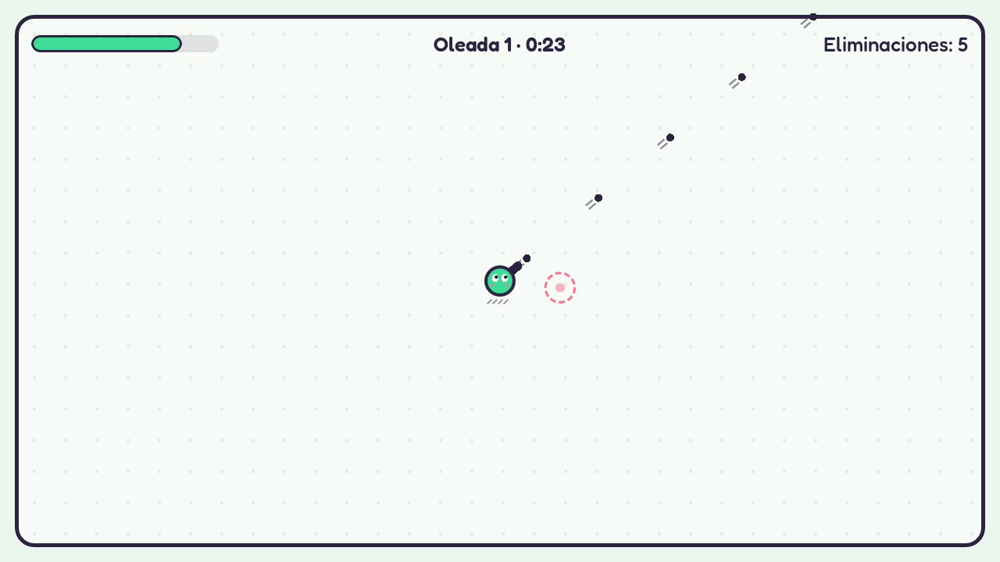
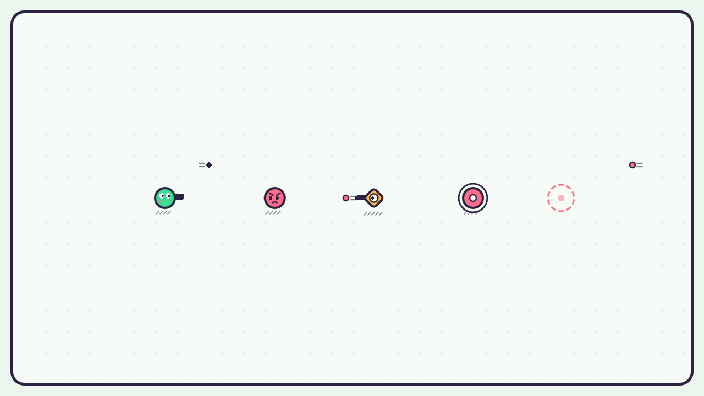
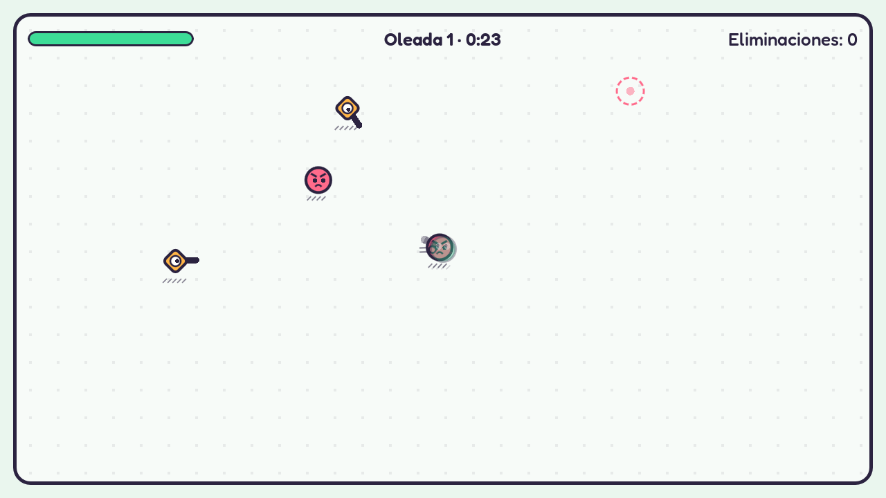
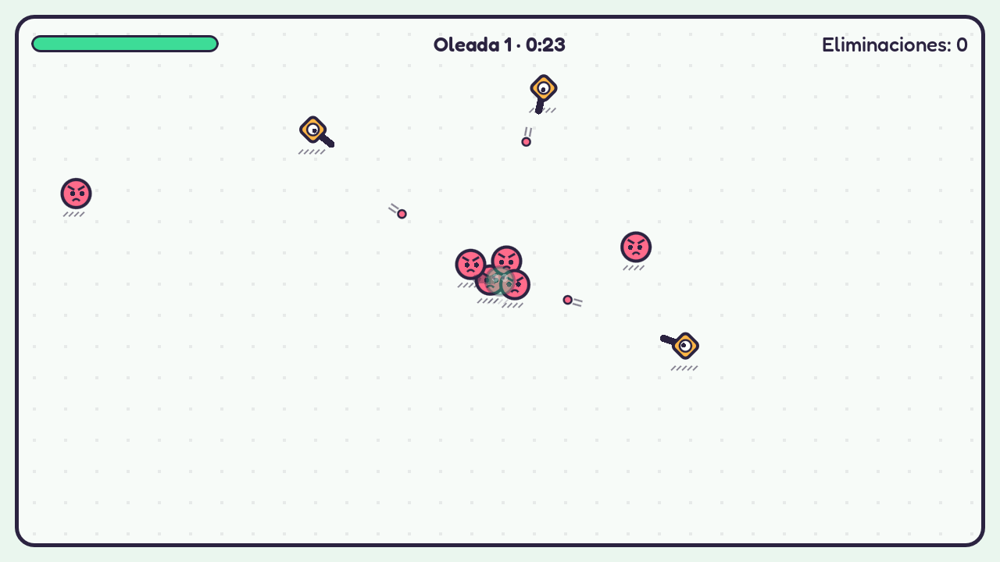

# Autelia

Juego de supervivencia por oleadas en 2D con vista superior, hecho en **Godot 4** con GDScript.
Es un juego completo y, a la vez, el **entorno experimental de una tesis** sobre adaptación
dinámica de la dificultad: cada partida se puede repetir con una semilla, la dificultad se
controla con un solo valor y el juego registra métricas del jugador en cada oleada.

**[▶ Jugar en el navegador](https://autelia.omard.space)** · funciona en escritorio con teclado y mouse.



## ¿Por qué "Autelia"?

El nombre viene de la **experiencia autotélica** de la teoría del flujo de Mihaly
Csikszentmihalyi: una actividad que se disfruta por sí misma. Eso ocurre cuando el reto está
equilibrado con la habilidad de quien juega, y mantener ese equilibrio es justamente el
objetivo de la dificultad adaptativa.

## Características

- **Movimiento libre y disparo con el mouse**, con 8 disparos por segundo e invulnerabilidad breve tras recibir daño.
- **Dos enemigos con roles distintos:**
  - el **perseguidor** te alcanza para dañarte por contacto;
  - el **tirador** mantiene distancia y dispara.
- **Oleadas de 30 segundos** con aviso visual antes de cada aparición y una arena limpia al empezar cada oleada.
- **Partidas repetibles:** con la misma semilla aparecen los mismos enemigos en los mismos lugares.
- **Dificultad con un solo valor** de 0 a 1 que ajusta el ritmo de aparición, la velocidad, la cadencia y la vida de los enemigos.
- **Telemetría por oleada en CSV:** precisión, daño hecho y recibido, eliminaciones, muertes y ritmo de juego.
- **Panel del investigador** (F3) para ver métricas en vivo y cambiar la dificultad.
- **Estilo visual propio,** dibujado por código: contornos de tinta, sombras rayadas y personajes con ojos que siguen la acción.
- **Efectos de sonido sintetizados** por un script del proyecto, sin recursos de terceros.

<p align="center">
  
</p>

## Cómo jugar

El menú principal ofrece:

- **Experimento:** la partida de la tesis, con dificultad fija (la condición de control). En el
  menú aparece como **Próximamente** y todavía no se puede elegir.
- **Puntajes:** la tabla global de Arcade y la del desafío de hoy, sin necesidad de jugar.
- **Modos → Desafío diario:** las reglas del Arcade, pero ese día todos juegan **la misma
  partida** (mismos enemigos en los mismos lugares). Cambia a la medianoche de cada jugador y
  su tabla muestra el mejor puntaje de cada nombre.
- **Modos → Arcade:** escribes un nombre (sin cuenta ni contraseña) y cada oleada es más difícil.
  Sumas 10 puntos por perseguidor, 20 por tirador y 50 × el número de oleada por cada oleada
  que sobrevives. Al morir, el puntaje se sube a una **tabla global** con los 10 mejores.

| Tecla | Acción |
|---|---|
| WASD o flechas | Moverse |
| Mouse + clic izquierdo | Apuntar y disparar |
| Esc o P | Pausa |
| R | Reiniciar al morir |
| F3 | Panel del investigador |
| F12 | Guardar una captura de pantalla |

En celulares y tabletas, el modo Arcade muestra **controles táctiles** al tocar la pantalla:
un joystick a la izquierda para moverse y otro a la derecha que apunta y dispara mientras lo
mantienes, más botones de pausa y de reinicio. Se juega con el teléfono en horizontal. En una
notebook táctil, el mouse sigue funcionando hasta que tocas la pantalla. El Experimento sigue
siendo para computadora con teclado y mouse.

## Ejecutar

Requiere [Godot 4.7](https://godotengine.org/).

```sh
godot --path .                                                    # jugar
godot --path . -- --seed=2026 --difficulty=0.7 --participant=P01  # sesión configurada
godot --path . -- --mute                                          # sin sonido
```

| Opción | Efecto |
|---|---|
| `--seed=N` | Fija la semilla de la partida (por defecto es aleatoria y se imprime al iniciar) |
| `--difficulty=D` | Dificultad inicial entre 0 y 1 (por defecto 0,5) |
| `--participant=ID` | Código anónimo del participante para la telemetría |
| `--mute` | Desactiva el sonido |
| `--touch` | Muestra los controles táctiles del Arcade aunque no haya pantalla táctil |

## Dificultad

Un único valor `d` controla cuatro parámetros de forma lineal. Con `d = 0,5` se obtiene el
ajuste base.

| Parámetro | d = 0 | d = 0,5 | d = 1 |
|---|---|---|---|
| Intervalo entre apariciones | 2,0 s | 1,4 s | 0,8 s |
| Velocidad de los enemigos | ×0,75 | ×1,0 | ×1,25 |
| Cadencia de disparo del tirador | ×0,6 | ×1,0 | ×1,4 |
| Vida de los enemigos | ×0,8 | ×1,0 | ×1,2 |

<p align="center">
  
  
  <br>
  <em>La misma oleada (semilla 2026) con dificultad 0,1 y con dificultad 0,9.</em>
</p>

En el modo Experimento la dificultad se mantiene **fija**, que es la condición de control. La
arquitectura admite controladores intercambiables: el ajuste por reglas y el modelo de la
tesis se agregarán sin modificar el juego. El modo Arcade usa uno de ellos, una rampa que
empieza en 0,3 y sube 0,07 por oleada hasta llegar a 1.

## Tabla global de puntajes

La tabla del modo Arcade vive en [Supabase](https://supabase.com) y el juego la consulta por
su API REST. Para configurarla:

1. Crea un proyecto en Supabase y ejecuta [`docs/leaderboard.sql`](docs/leaderboard.sql) y
   [`docs/daily_challenge.sql`](docs/daily_challenge.sql) en el editor SQL.
2. Copia [`online/leaderboard.example.cfg`](online/leaderboard.example.cfg) como
   `online/leaderboard.cfg` y escribe la URL del proyecto y la clave pública (*publishable* o
   *anon*). Nunca la clave secreta. Git ignora ese archivo y la exportación web lo incluye.

La clave pública queda dentro del juego a propósito: las reglas de seguridad de la tabla solo
permiten leer e insertar puntajes con valores razonables, nunca editarlos ni borrarlos. Sin
configuración, o sin conexión, el juego funciona igual y la tabla muestra un aviso.

## Telemetría

Cada oleada es una ventana de medición y genera una fila en
`user://telemetry/<participante>_<sesión>.csv`. En Linux:
`~/.local/share/godot/app_userdata/Autelia/telemetry/`.

| Campo | Descripción |
|---|---|
| `participant_id`, `session_id` | Participante y sesión |
| `condition`, `seed`, `window`, `difficulty` | Condición, semilla, número de oleada y dificultad aplicada |
| `shots`, `hits`, `accuracy` | Disparos, impactos y precisión |
| `damage_dealt`, `damage_taken` | Daño causado y recibido |
| `kills`, `deaths` | Eliminaciones, y si la ventana terminó por la muerte del jugador |
| `active_time`, `kills_per_minute` | Tiempo jugado en la ventana y ritmo de eliminaciones |

Los datos de participantes nunca se guardan en el repositorio.

## Estructura

```
autoload/      Bus de eventos global y utilidades de desarrollo
core/          Jugador, enemigos, combate, arena y estilo de dibujo
modes/         Reglas de cada modo de juego (supervivencia por oleadas, puntaje del Arcade)
difficulty/    Valor de dificultad, su efecto en los parámetros y los controladores
telemetry/     Registro de métricas por oleada en CSV
online/        Tabla global de puntajes en Supabase
ui/            Menús, HUD y panel del investigador
audio/         Reproducción de efectos de sonido
tools/         Capturas guionadas, generador de sonidos y entorno de pruebas
tests/         Pruebas automáticas por etapa
docs/          Arquitectura e imágenes del README
```

La regla principal de la arquitectura es que el núcleo del juego y los modos **solo emiten
eventos**. El HUD, el sonido, la telemetría y la dificultad escuchan esos eventos sin
modificar la jugabilidad. Más detalle en [`docs/architecture.md`](docs/architecture.md).

## Pruebas y herramientas

```sh
godot --headless --path . tests/smoke_stage1.tscn         # una prueba por etapa: 1–5, 7, sound, feel, arcade, touch y daily
godot --path . tools/capture/capture.tscn -- etapa7-alta  # genera una captura guionada
python3 tools/sfx/generate_sfx.py                         # regenera los sonidos de assets/audio/
```

## Publicar la versión web

La exportación web es de un solo hilo, así que funciona en cualquier hosting estático sin
configuración especial. Requiere las plantillas de exportación web de Godot 4.7.2.

```sh
godot --headless --path . --export-release "Web" build/web/index.html
cd build/web && npx vercel deploy --prod      # publica en autelia.omard.space
```

## Documentación de la tesis

El desarrollo se documenta en una bitácora de tesis, con decisiones, verificación y evidencia
de cada etapa. Se mantiene fuera de este repositorio.

## Créditos

- Desarrollo: Omar García ([@OmarDavidd](https://github.com/OmarDavidd)).
- Tipografía [Fredoka](https://fonts.google.com/specimen/Fredoka), con licencia SIL Open Font License ([`assets/fonts/OFL.txt`](assets/fonts/OFL.txt)).
